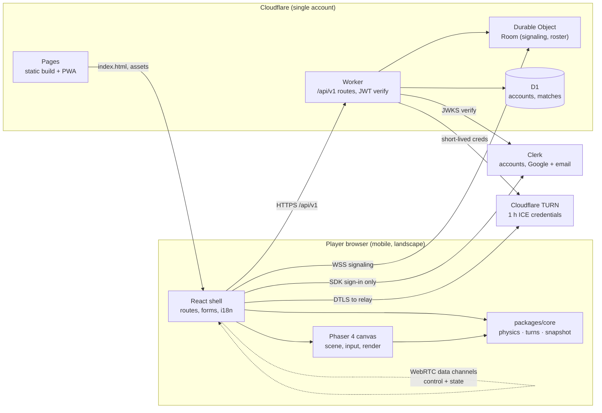
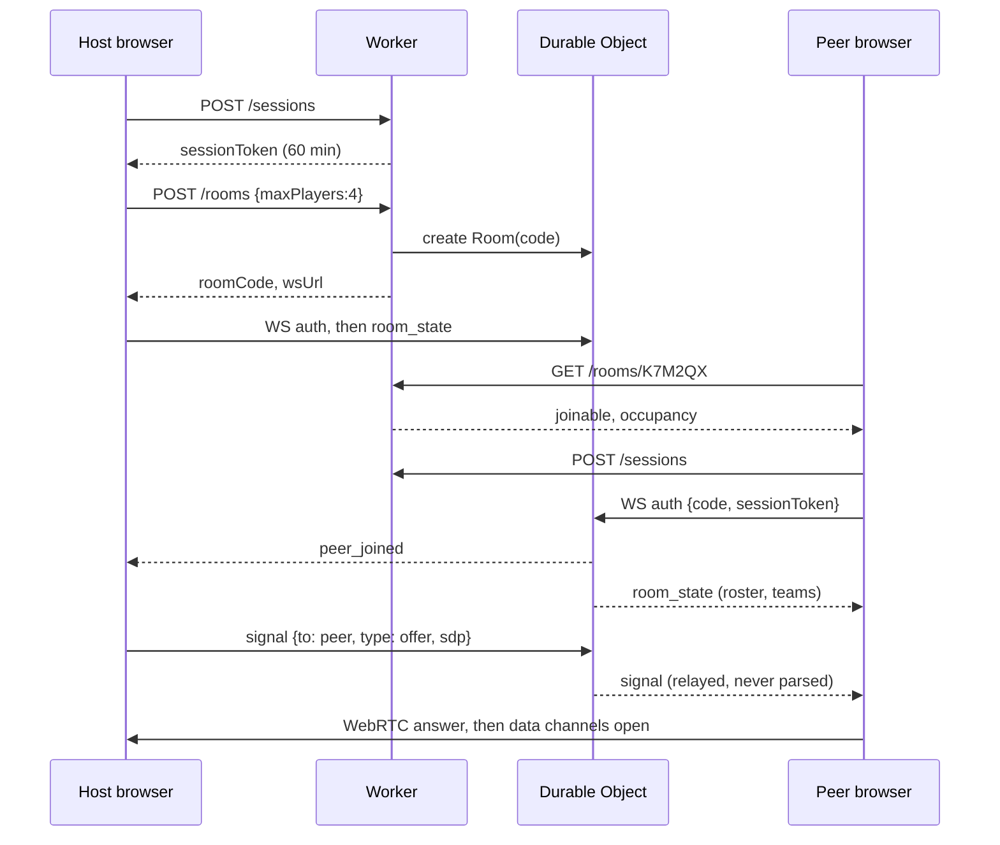
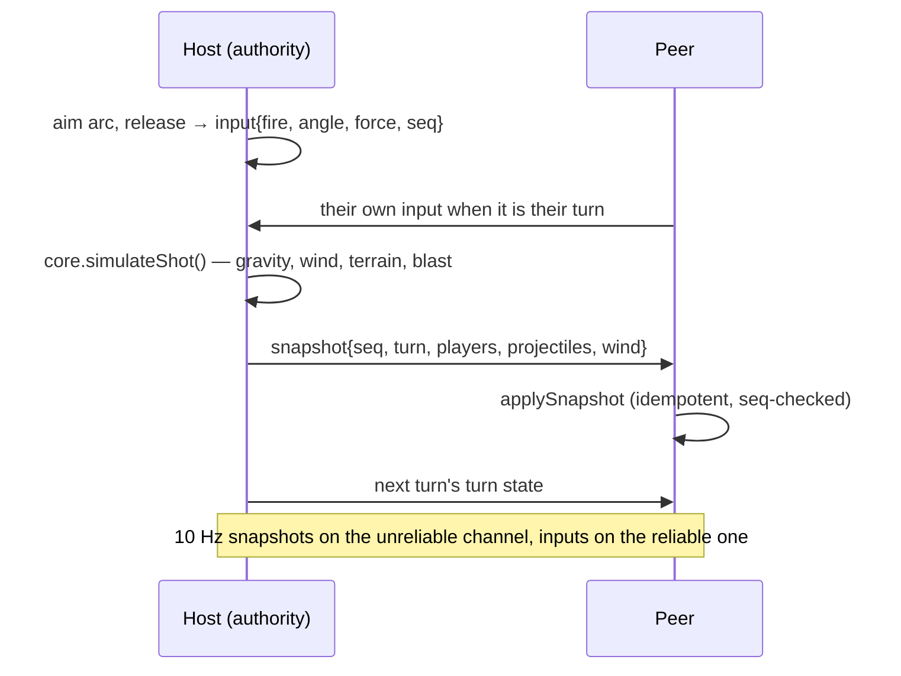
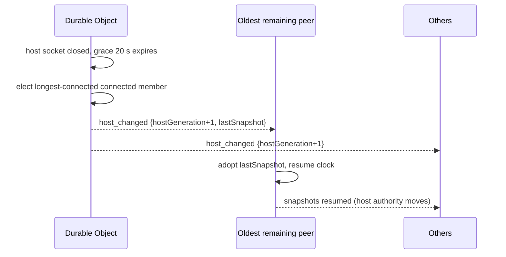

# Architecture

Three deployables and one shared library: a Phaser canvas inside a React shell (`apps/web`), a pure simulation library
with no framework or network dependency (`packages/core`), and one Cloudflare Worker that both serves the API and hosts
the room Durable Object (`apps/worker`). The heavy realtime work — physics, turns, damage — runs in the browsers and is
never sent to the Worker, whose CPU budget is 10 ms per request `[spec: gbw-spec.md#2.4]`.

## Context



Every arrow is either a request we serve, a service we call, or a peer connection we can name. Peer-to-peer links are
drawn client-to-client because the data never leaves the browsers except through a TURN relay when a direct path fails.

## Components

| Component | Responsibility | Technology | Owns data |
|-----------|----------------|-----------|-----------|
| `apps/web` shell | Routes, forms, i18n, session token, calling the API | React 19, Vite 8, TypeScript 5, react-router | `localStorage` settings (`locale`), `sessionStorage` last result |
| `apps/web` scene | Rendering, touch input, HUD wiring, applying snapshots | Phaser 4.2 (canvas), `Phaser.Scale.FIT` | Nothing beyond the frame |
| `packages/core` | Ballistics, turn order, damage, snapshot encode/decode, tunables | Pure TypeScript, no DOM/Phaser/network imports | Nothing |
| `apps/worker` API | HTTP endpoints, JWT verification, Elo, D1 writes, rate limits | Cloudflare Workers (ES modules) | Writes `match_record`, `rating_history` |
| `apps/worker` `Room` DO | One instance per room: roster, teams, signaling relay, host election, host snapshot cache | Durable Objects, `ctx.storage`, alarms | `RoomState`, `lastSnapshot` |
| D1 `GBW_DB` | Durable records: accounts, profiles, matches, rating history | D1 (SQLite) | The system of record |
| Clerk | Identity, sessions, OAuth, deletion | Managed service | The only place an email is stored |
| Cloudflare TURN | Relay when NAT traversal fails | Managed service | Nothing (no logging of credentials) |

The dependency direction is strict: `core` imports nothing from `web` or `worker`; `web` and `worker` both import
`core`; the DO never imports UI code. This is what makes the simulation unit-testable without a browser
(`NFR-22`).

## Key flows

### 1. Create a room and pair two players



The DO relays signaling without inspecting SDP and never sees media or game traffic (`ADR-0004`).

### 2. A shot, from touch to damage



### 3. Host migration



Target: ≤ 5 s from failure to playable (`NFR-06`). `hostGeneration` makes stale host messages ignorable.

### 4. Recording a result

The host sends `match_end` to the DO, then `POST /matches` with its Clerk JWT (registered) or session token (guest). The
Worker validates the room finished, computes Elo once, writes `match_record` + `match_player` + `rating_history` in a
batch, and returns deltas. The DO broadcasts `match_recorded` so every client shows the same numbers
(`matches.md`).

## Cross-cutting concerns

| Concern | How it is handled |
|---------|-------------------|
| Authentication | Two tokens: Clerk JWT (short-lived, `/me`, `/matches`) and a 60-min `sessionToken` from `POST /sessions` (WebSocket, TURN, rooms). The WS sends it in the first message, never in the URL `[assumption: OQ-27]` |
| Authorisation | Server-side on every endpoint (object ownership); the DO checks host-only messages; the client never decides a permission (`NFR-11`) |
| Errors | RFC 9457 `application/problem+json` from the API; UI shows a translated sentence + `request_id`, never a raw code |
| Logging | One JSON line per request: `request_id`, `route`, `status`, `duration_ms`, no tokens, no display names (`NFR-12`, `NFR-24`) |
| Configuration | Worker vars/secrets via `wrangler.jsonc` (per environment); web build gets `VITE_*`; tunables in `packages/core/src/tuning.ts` (`NFR-23`) |
| i18n | Flat JSON tables per locale in `apps/web/src/i18n`, typed keys, no literal strings in components (`NFR-18`) |
| Time | All timestamps ISO-8601 UTC strings; the client renders in the device locale |

## Source layout

```
gb-web/
├─ apps/
│  ├─ web/
│  │  ├─ src/app/          router, providers, layout shell
│  │  ├─ src/routes/       one folder per route (main, sign-in, profile, leaderboard, lobby, match, results)
│  │  ├─ src/game/         Phaser scenes, input, HUD bridge
│  │  ├─ src/net/          ws client, datachannel client, session token
│  │  ├─ src/i18n/         vi.json, en.json, typed t()
│  │  └─ public/           manifest, icons, audio
│  └─ worker/
│     ├─ src/index.ts      router + fetch handler
│     ├─ src/routes/       sessions, rooms, me, matches, leaderboard, health
│     ├─ src/room-do.ts    the Room Durable Object
│     ├─ src/db/           D1 queries
│     └─ migrations/       NNNN_*.sql applied by wrangler
├─ packages/
│  └─ core/src/            physics, turn, damage, snapshot, tunables.json
├─ packages/core/tests/    Vitest unit tests for the simulation
├─ apps/worker/tests/      Vitest + miniflare endpoint tests
├─ apps/web/tests/         Vitest + RTL component tests
├─ tests/e2e/              Playwright two-browser tests
├─ tests/meta/             repo-wide checks (doc/traceability/secret scans)
└─ docs/                   this doc set
```

## Oracle

| Claim | Checked by |
|-------|-----------|
| `packages/core` has no DOM/Phaser/network imports | `packages/core/tests/imports.test.ts` — static import scan of `packages/core/src` (TC-FND-018) |
| Snapshot payload ≤ 800 B at 8 players | `packages/core/tests/snapshot.test.ts` (TC-CORE-041) |
| Signaling relays SDP without parsing and never persists it | `apps/worker/tests/signaling.test.ts` (TC-ROOM-050) |
| Host election picks the longest-connected member and bumps `hostGeneration` | `apps/worker/tests/room.test.ts` (TC-ROOM-048) |
| Match record + Elo written exactly once per match | `apps/worker/tests/matches.test.ts` (TC-RANK-110) |
| No token or display name in log lines | `apps/worker/tests/logging.test.ts` (TC-OPS-118) |
