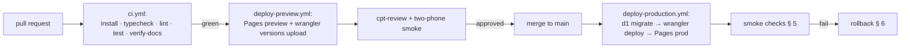

# Deployment

Two long-lived environments and one per pull request. There is **no staging**: preview deploys plus the M1/M2 gates carry
that role `[user: interview R4 environments]`.

## 1. Environments

| Environment | Web | API + DO | D1 | Clerk | TURN | Purpose |
|-------------|-----|----------|----|-------|------|---------|
| `local` | `vite` on :5173 | `wrangler dev` on :8787 (miniflare) | local SQLite | Clerk test instance | not used | Development and all automated tests |
| `preview` | `https://<hash>.gbw-pages.pages.dev` per PR | `gbw-api-preview` worker | `gbw-preview` (`c969e339…`) | Clerk test instance | test key | QA on real phones, UAT (`M2`) |
| `production` | `https://gbw-pages.pages.dev` | `gbw-api` on `https://gbw-api.gbw-demo.workers.dev` | `gbw` (`1a3895e6…`) | Clerk **test** instance (no production instance exists yet) | production | Players |

**There is no domain, so there is no custom hostname.** The account has no Cloudflare zone, so `production` answers on the
workers.dev hostname Cloudflare gives the account (`gbw-demo`) and the web app on the Pages project's own subdomain. That
also means the API and the app are on **different origins**: `VITE_API_BASE` must be absolute (the deploy workflow takes it
from `vars.PRODUCTION_API_URL`) and the worker's `ALLOWED_ORIGINS` names the Pages host, with `https://*.gbw-pages.pages.dev`
covering previews.

A Clerk **production** instance needs a domain — its creation dialog demands one — so the deployed app runs the test instance
and its sessions are unranked. Buying a domain is the only thing standing between this and a real production deployment;
when one exists, add it as a zone, put a custom-domain route back on the worker, switch `ALLOWED_ORIGINS` to the real host and
create the Clerk production instance.

Production requires the domain to be HTTPS-only with HSTS; iOS refuses secure-context APIs otherwise (`NFR-09`,
`environment-setup.md` § 7). That rule is unverified today because no domain exists.

## 2. What gets deployed

| Artefact | Command | Produces |
|----------|---------|----------|
| Web | `pnpm build` → `apps/web/dist` | Static SPA + PWA manifest + service worker |
| Worker | `pnpm exec wrangler deploy --env production` | API and the `Room` DO class (migration tag `v1`, `v2`, …) |
| D1 schema | `pnpm exec wrangler d1 migrations apply gbw-db --remote` | Applied before the Worker that needs it |
| Tunables | shipped inside `packages/core` | Changing them bumps `rulesetVersion` (`NFR-23`) |

Order matters: **D1 migrations → Worker → Pages**. A Worker that expects a column the database does not have fails every
request; a Pages deploy that references an endpoint the Worker does not serve yet fails only that route.

## 3. Per-environment configuration

| Setting | preview | production |
|---------|---------|------------|
| `ENVIRONMENT` | `preview` | `production` |
| `VITE_API_BASE` | preview Worker URL | `https://api.gbw.<domain>/api/v1` |
| `VITE_CLERK_PUBLISHABLE_KEY` | test instance key | production instance key |
| Clerk instance | test | production |
| `SESSION_TOKEN_SECRET` | preview secret | production secret (rotated quarterly) |
| TURN key | test | production |
| Rate limits | 100 rooms/min (relaxed) | 10/min per IP, 30/h per account (`NFR-25`) |
| Log retention | 3 days | 3 days (`NFR-24`) |

Secrets live in GitHub Actions secrets and `wrangler secret put`; `wrangler.jsonc` holds only non-secret vars and
bindings.

## 4. Pipeline (GitHub Actions)

| Workflow | Trigger | Steps |
|----------|---------|-------|
| `ci.yml` | every push, every PR | Job *checks*: `pnpm install --frozen-lockfile`, `pnpm typecheck`, `pnpm lint`, `pnpm test`, `pnpm build`, `pnpm budget`, `node .agents/scripts/verify-docs.mjs`. Job *playwright*: install, `playwright install --with-deps chromium`, a dummy `apps/worker/.dev.vars`, both servers, `pnpm e2e`. The OpenAPI document is checked by `tests/meta/openapi.test.ts`, not by a linter step |
| `deploy-preview.yml` | PR opened/updated, same-repo branches only | Build with preview env, `wrangler d1 migrations apply --remote --env preview`, `wrangler versions upload --env preview`, Pages deploy `--branch pr-<n>` |
| `deploy-production.yml` | a green `CI` run on `main`, or manual dispatch | Migrate, deploy Worker, deploy Pages, verify the deployed sha, post the release record (`cpt-release`). The job only arms when the repository variable `PRODUCTION_READY` is `true`; before `US-FND-004` it would otherwise fail on an empty token after every merge |

CI needs: `CLOUDFLARE_API_TOKEN`, `CLOUDFLARE_ACCOUNT_ID`, `VITE_CLERK_PUBLISHABLE_KEY`, and the worker secrets mirrored
for the deploy step. A PR from a fork does not get secrets and therefore does not deploy.

## 5. Smoke checks after every production deploy

| Check | Command | Pass |
|-------|---------|------|
| API alive | `curl -fsS https://api.gbw.<domain>/api/v1/health` | `200`, `{"status":"ok","version":"<git sha, or the deploy tag>"}` |
| Static app | `curl -fsSI https://gbw.<domain>/` | `200`, `content-type: text/html`, service worker reachable |
| Sign-in route loads Clerk | Playwright `tests/e2e/prod-smoke.spec.ts` against production (release-stage check, `cpt-release` RR7 — not a design oracle) | Sign-in card renders for both locales |
| Room round trip | Same spec: two contexts create/join a room | Roster shows 2 members within 5 s |
| Migration state | `wrangler d1 migrations list gbw-db --remote` | No pending migration |
| Rollback target known | `wrangler deployments list --env production` | Previous version id recorded in the release note |

Record the results in the release record (`docs/07-release/REL-…`); a release with a missing smoke line is not
signed off.

## 6. Rollback

| Situation | Action | Time |
|-----------|--------|------|
| Bad Worker deploy | `pnpm exec wrangler rollback --env production --message "rollback REL-x"` | < 2 min |
| Bad web build | Pages dashboard → previous deployment → *Rollback* (or `git revert` + redeploy) | < 5 min |
| Bad D1 migration | Forward-fix migration only. Migrations are additive; a destructive change needs a two-step deploy (add column → backfill → drop in a later release) | next deploy |
| DO class change that breaks live rooms | Deploy with a **new** migration tag and keep the old class bound for 24 h so existing rooms drain | planned |
| Security incident | Revoke the TURN key and rotate `SESSION_TOKEN_SECRET` (all sessions drop), then `cpt-ops` incident record | < 15 min |

A rollback keeps the database as it is: every migration in this project is backwards-compatible for at least one
release.

## 7. Who may deploy

| Action | Who |
|--------|-----|
| Merge to `main` | Any developer with an APPROVE from `cpt-review` |
| Approve the production workflow | The tech lead (GitHub environment protection rule) |
| Apply a production migration manually | Tech lead only, announced in the team channel beforehand |
| Rotate secrets | Tech lead; record in `08-ops/runbook.md` § secrets |
| `wrangler rollback` | Whoever is on call, then notify the team |

## Oracle

| Contract | Checked by |
|----------|-----------|
| Pipeline order (migrate → worker → pages) | `.github/workflows/deploy-production.yml` review + `tests/e2e/prod-smoke.spec.ts` (release-stage check, `cpt-release` RR7) (TC-FND-901) |
| Smoke checks all pass on production | Release record `docs/07-release/REL-…` evidence line |
| Rollback returns the previous version serving 200 | `tests/e2e/prod-smoke.spec.ts` re-run after `wrangler rollback` (release-stage check, `cpt-release` RR7) (TC-FND-902) |
| No secret in `wrangler.jsonc` or the web build | `tests/meta/bundle-secrets.test.ts` builds the SPA into a temp dir and greps every asset for the secret names and for the values in an untracked `apps/worker/.dev.vars` (TC-FND-012) |
