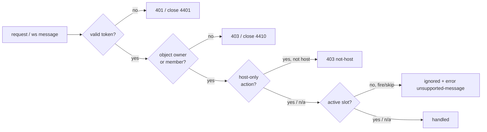

# Roles and permissions

Four roles, defined by what a connection *is*, not by a menu the user picks. A role is decided server-side and the
client only mirrors it.

## Roles

| Code name | Who | Granted when | Where it is checked |
|-----------|-----|--------------|---------------------|
| `guest` | Anonymous visitor with a `guestId` in `localStorage` | On first room creation, no account | `POST /sessions` returns `subject.kind: guest`; every guest call carries a session token |
| `registered` | Clerk-signed-in account with a D1 profile | After sign-in and profile creation | Clerk JWT verification on `/me`, `/matches` |
| `host` | The member who created the room, or the elected successor | Room creation; or host election after a host leaves (`ADR-0004`) | `Room.hostPlayerId` inside the DO; `start_match`, `team_assign` rejected when `playerId !== hostPlayerId` |
| `peer` | Any other member of a room | Successful WS `auth` for that room | Membership lookup in `Room.members` |

Two orthogonal attributes exist on top of the role: `team` (`A`/`B`, or `null` before assignment) and *active slot* (the
`slot` equal to `turn.activeSlot`). Both are state, not roles — a peer keeps its `team` across turns, and `host` may hold
any slot.

## Permission matrix

| Capability | guest | registered | host | peer |
|------------|:-----:|:----------:|:----:|:----:|
| Create a room | ✅ | ✅ | — | — |
| Join a room by code | ✅ | ✅ | — | — |
| View `GET /rooms/:code` preview | ✅ | ✅ | ✅ | ✅ |
| Edit own display name / avatar | ❌ (no profile) | ✅ | ✅ | ✅ |
| Delete own account | ❌ | ✅ | ✅ | ✅ |
| Assign teams / move a player | ❌ | ❌ | ✅ own room | ❌ |
| Start the match | ❌ | ❌ | ✅ own room | ❌ |
| Fire / skip on own turn | ✅ in room | ✅ in room | ✅ when it is the active slot | ✅ when it is the active slot |
| Send chat / emote | ✅ in room | ✅ in room | ✅ | ✅ |
| Reconnect to a running room | ✅ | ✅ | ✅ | ✅ |
| Submit the match result | ❌ unless the only member | ✅ (host or sole) | ✅ | ❌ |
| Earn a rating change | ❌ always unranked | ✅ ranked matches only | ✅ | ✅ |
| Read the leaderboard | ✅ | ✅ | ✅ | ✅ |
| Read another account's profile or history | ❌ | ❌ | ❌ | ❌ |
| Get TURN credentials | ✅ in room | ✅ in room | ✅ | ✅ |
| See other players' `accountId` / `guestId` | ❌ | ❌ | ❌ | ❌ |

`—` means the capability is not role-specific: a host is, by definition, also a room member.

## How each check is enforced

| Check | Implementation site |
|-------|---------------------|
| Token validity | `apps/worker/src/auth.ts` — Clerk JWKS for JWT, DO `secret` table lookup for session tokens |
| Object ownership | Route guard per endpoint: `accountId === jwt.sub` for `/me*`; membership for rooms |
| Host-only | `apps/worker/src/room-do.ts` — compare `playerId` with `hostPlayerId` before handling `start_match` / `team_assign` |
| Active slot | Same file, compare `slot` with `turn.activeSlot`; the *client* also disables input, but that is courtesy only |
| Ids are not exposed | Every response mapper strips `accountId`/`guestId` except to the owner (`accounts.md`) |

## Rules that follow from this

1. A guest can never appear on the leaderboard and cannot submit a ranked result — the server marks `ranked: false` for
   any match containing a guest slot (`matches.md`).
2. Deleting an account mid-match is refused (`409`) until the room ends; otherwise a player could erase a rating loss
   (`accounts.md`).
3. Only the room's current host may start or assign teams; after migration the new host inherits both rights and the old
   host's messages are ignored by generation.
4. The DO never trusts a client-declared role, team or slot — it reads them from `RoomState`.
5. An account may hold at most one live connection per room; a second socket with the same subject replaces the first
   (a phone reconnecting on cellular) rather than counting as a new member.

## Oracle

| Contract | Checked by |
|----------|-----------|
| Guest cannot start a match, assign teams, or reach `/me` | `apps/worker/tests/authz.test.ts` (TC-AUTH-065) |
| Non-host `start_match` → `error not-host`, room unaffected | `apps/worker/tests/room.test.ts` (TC-ROOM-066) |
| Fire from a non-active slot is ignored and produces an error | `apps/worker/tests/room.test.ts` (TC-NET-067) |
| Responses never contain another member's `accountId`/`guestId` | `apps/worker/tests/privacy.test.ts` (TC-AUTH-075) |
| Second socket from the same subject replaces the first | `apps/worker/tests/room.test.ts` (TC-ROOM-068) |
| Account deletion is refused while in an active room | `apps/worker/tests/accounts.test.ts` (TC-AUTH-069) |
