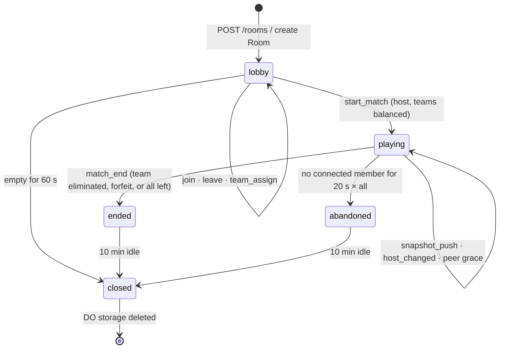
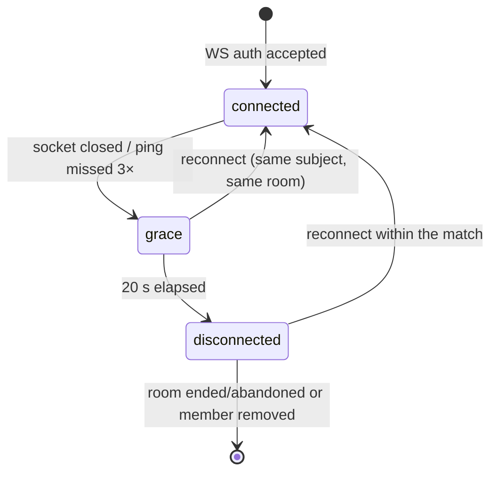

# Workflow state machines

Four state machines decide everything that can "happen" in this product. Any transition not in these tables is a bug,
not a feature — if a new one is needed, it is a change request (`cpt-change`), not an invention in code.

## 1. Room lifecycle (`RoomState.status`)

| From | To | Trigger | Guard | Emits | Side effects |
|------|----|---------|-------|-------|--------------|
| — | `lobby` | `POST /rooms` | `maxPlayers ∈ {2,4,6,8}` | `room_state` | Room storage initialised; 10 min idle alarm set |
| `lobby` | `lobby` | `peer_joined` | slot available, room not full | `peer_joined` → others, `room_state` → all | `lastActivityAt` updated |
| `lobby` | `lobby` | `team_assign` | sender is host, whole roster in one frame, result balanced | `room_state` | — |
| `lobby` | `playing` | `start_match` | host only; every slot filled; both teams non-empty and equal; no unassigned member | `match_started` | `matchStartedAt` set; 24 h hard cap alarm armed |
| `lobby` | `closed` | last member left | members empty | — | 60 s timer, then storage delete |
| `playing` | `playing` | `snapshot_push` | sender is current host, ≤ 8 KB | — | `lastSnapshot` replaced (never appended) |
| `playing` | `playing` | `host_changed` | host election ran | `host_changed` | `hostGeneration++` |
| `playing` | `ended` | `match_end` | sender is current host; `winnerTeam ∈ {A,B}` | `room_state`, then `match_recorded` after the API accepts | `endedAt`, result frozen |
| `playing` | `abandoned` | all members `disconnected` | grace expired for every member | — | Room marked unranked; no rating change |
| `ended`/`abandoned` | `closed` | 10 min idle | — | — | Storage delete |

Terminal for gameplay: `ended` and `abandoned`. A `closed` room can never be rejoined — `GET /rooms/:code` answers `410`.

## 2. Turn (`turn.phase`)

| From | To | Trigger | Guard | Emits |
|------|----|---------|-------|-------|
| `idle` | `awaiting_input` | `match_started`, or previous turn resolved | active slot connected | snapshot with `turn.deadlineAt = now + 20 s` |
| `awaiting_input` | `resolving` | `input{kind:'fire'}` | sender owns `activeSlot`, `seq` newer | snapshot at 10 Hz while projectile flies |
| `awaiting_input` | `resolving` | `input{kind:'skip'}` | sender owns `activeSlot` | snapshot with no projectile |
| `awaiting_input` | `resolving` | 20 s elapsed | — | snapshot with `turn.endedBy: 'timeout'` |
| `awaiting_input` | `resolving` | active player enters `grace` | — | snapshot with `turn.endedBy: 'disconnect'` |
| `resolving` | `idle` | projectile landed or left bounds; damage applied | — | snapshot with `turn.number + 1` |
| `idle` | `idle` | queue wraps: every player has acted once | `turn.round + 1` | `weather` re-rolled and broadcast before the next snapshot |
| any | `ended` | a team has all `hp = 0` | — | `match_end` |

Rotation skips eliminated players and players in `disconnected`. A turn that times out never carries over: the next
player gets a full 20 s.

**Round boundary.** The turn queue is a delay priority queue, so "everyone has acted once" is the moment the queue
pointer wraps: `turn.round` increments there and only there, which is also the only moment the **weather** changes
(`tunables.md` § 1.3). Inside a round the wind is a constant, so a queue-jumping mobile (low delay) still sees the same
wind as the player who acted first.

## 3. Connection (per `Member.connectionState`)

| From | To | Trigger | Effect on the match |
|------|----|---------|---------------------|
| — | `connected` | `auth` with a valid session token for this room | Slot reserved; `peer_joined` |
| `connected` | `grace` | socket close, or 3 missed `ping`s (≈ 15 s) | Their turn is skipped; they stay in the roster |
| `grace` | `connected` | new socket with the same subject | Full `room_state` + `lastSnapshot` sent; no replay of missed messages |
| `grace` | `disconnected` | 20 s elapsed (`NFR-07`) | Turns skip; team keeps their slot; if they are host, election runs |
| `disconnected` | `connected` | reconnect during `playing` | Snapshot restored; **no** re-entry animation, no rating penalty |
| `disconnected` | removed | host explicitly removes, or room ends | Their result is `abandon` if the team forfeits; once the room is `abandoned`, every seat's stored row is `abandon` |

Forfeit rule: a team loses when **every** member of it is `disconnected`. One disconnected player never forfeits a match
`[user: interview R5 disconnects]`.

## 4. Result recording (`match_record`)

| From | To | Trigger | Guard | Effect |
|------|----|---------|-------|--------|
| — | `pending` | client shows results screen | — | `POST /matches` in flight |
| `pending` | `recorded` | `201` from `POST /matches` | room `status = ended`, caller is host or sole member, `matchId` new | Rows written; deltas returned; `match_recorded` broadcast |
| `pending` | `failed` | `4xx`/`5xx` | — | Banner + retry; nothing counted |
| `pending` | `recorded` | `409 match-already-recorded` | — | The stored record is returned instead |
| `recorded` | `recorded` | any repeat submit | — | Idempotent no-op |

An `abandoned` room writes **no** rating change for anyone and every seat's row says `result: 'abandon'`, the side that
stayed included (`matches.md` § `abandoned`); the room's `match_recorded` broadcast keeps `win` for the survivors.

## Invariants

1. `status = playing` implies `matchStartedAt` is set and every member has a `slot` and a `team`.
2. `hostGeneration` only increases, and exactly one member is host at any instant.
3. `turn.activeSlot` always names a member with `hp > 0` and `connectionState = connected` at the moment the turn starts.
4. A snapshot's `seq` is strictly increasing per match and never reused after migration.
5. `ended` is irreversible: no message can return a room to `playing`.

## Oracle

| Contract | Checked by |
|----------|-----------|
| Legal transitions only; illegal ones rejected without side effects | `apps/worker/tests/state-machine.test.ts` (TC-ROOM-162), property test over random event sequences |
| `start_match` guards (equal, non-empty, assigned) | `tests/e2e/lobby.spec.ts` (TC-ROOM-148) |
| Turn timeout, disconnect-skip, elimination skip | `packages/core/tests/turn.test.ts` (TC-CORE-152), `apps/worker/tests/room.test.ts` (TC-NET-067) |
| Grace 20 s boundaries and reconnect restore | `tests/e2e/reconnect.spec.ts` — planned, see `05-quality/test-plan-status.md` (TC-ROOM-046, TC-ROOM-047) |
| Forfeit only when a whole team is gone | `apps/worker/tests/room.test.ts` (TC-ROOM-070) |
| `match_recorded` exactly once per match | `apps/worker/tests/matches.test.ts` (TC-RANK-111) |
