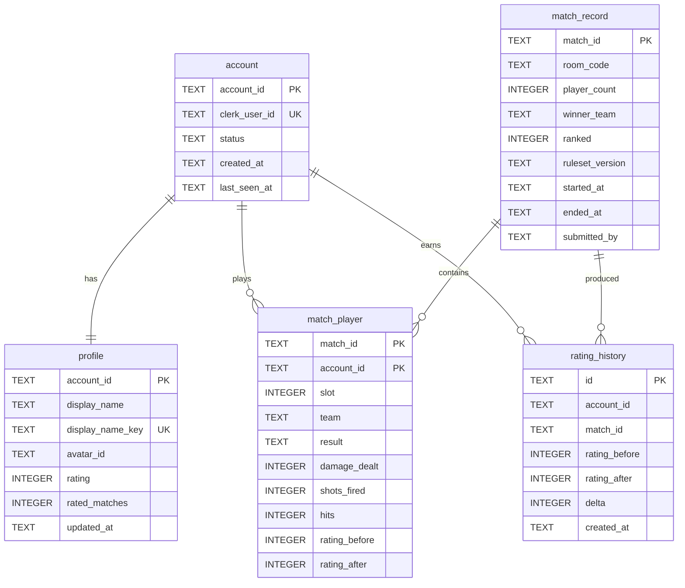

# Data reference

Two stores, one owner each ([ADR-0003](../../04-decisions/adr/ADR-0003-data-d1.md)):

- **D1** (`GBW_DB`) — every durable record: `account`, `profile`, `match_record`, `match_player`, `rating_history`.
- **Durable Object storage** — ephemeral room state only, deleted when a room closes (`room-state.md`).

Migrations live in `apps/worker/migrations/NNNN_<slug>.sql`, are applied with
`wrangler d1 migrations apply GBW_DB --local|--remote`, and are forward-only; a revert is a new migration.

## Entity index

| Table | Purpose | File | Written by |
|-------|---------|------|-----------|
| `account` | Registered identity mirror of Clerk | [accounts.md](accounts.md) | Worker on first authenticated request |
| `profile` | Public name, avatar, rating | [accounts.md](accounts.md) | Worker; rating only from the match pipeline |
| `match_record` | One played match | [matches.md](matches.md) | Worker `POST /api/v1/matches` |
| `match_player` | Per-player outcome and contribution | [matches.md](matches.md) | Same call, same transaction |
| `rating_history` | Audit trail of every rating change | [matches.md](matches.md) | Same call, same transaction |

## Diagram

## Storage conventions

| Convention | Rule |
|------------|------|
| Ids | UUIDv4 in a `TEXT` primary key; never an auto-increment exposed to a client |
| Timestamps | ISO-8601 UTC text (`2026-11-04T09:15:00Z`), stored in `TEXT`; comparisons are lexicographic |
| Booleans | `INTEGER` 0/1 with a `CHECK` constraint |
| Enums | `TEXT` with a `CHECK (... IN (...))`; values are listed in the [glossary](../../01-overview/glossary.md#status-values-in-one-place) |
| Money/decimals | none in v1 |
| Soft delete | `account.status = 'deleted'` plus a purge job; nothing else is soft-deleted |
| Naming | `snake_case` columns, plural-free table names (`match_record`, not `matches`) |
| PII | No email, phone, address or IP columns anywhere (`NFR-13`) |

## Oracle

| Contract | Checked by |
|----------|-----------|
| Migrations produce exactly these tables, columns, constraints and indexes | `tests/worker/migrations.test.ts` (TC-FND-100) |
| `account` / `profile` write paths and the unique display-name key | `tests/worker/accounts.test.ts` (TC-AUTH-101…TC-AUTH-103) |
| `match_record` / `match_player` / `rating_history` written in one batch, once per match | `tests/worker/matches.test.ts` (TC-RANK-110, TC-RANK-111) |
| Leaderboard index serves the keyset page without a table scan | `tests/worker/leaderboard.test.ts` (`EXPLAIN QUERY PLAN` assertion, TC-RANK-104) |
| `RoomState` / `Member` shape and persistence via `ctx.storage` | `tests/worker/room.test.ts` (TC-ROOM-147…TC-ROOM-073) |
