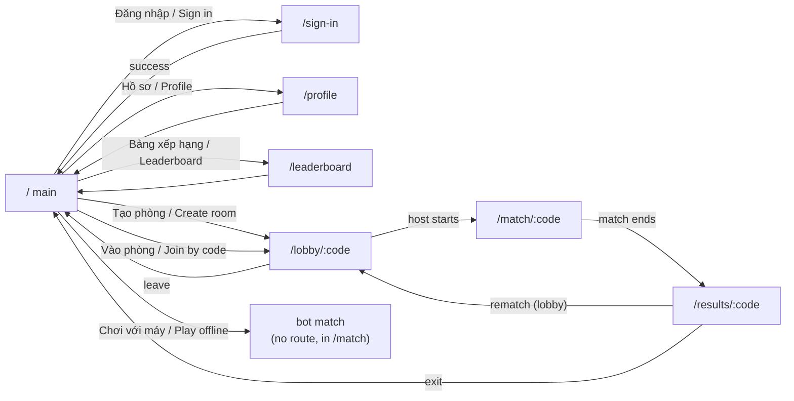

# Screens

Seven routes, one landscape layout. There is no design file in `docs/00-source/` — the layout tables in these files **are**
the design reference, and the components follow them ([NFR-17](../../01-overview/nonfunctional-requirements.md),
[NFR-19](../../01-overview/nonfunctional-requirements.md)).

## Screen index

| Route | Screen | Roles | Auth | File | Story |
|-------|--------|-------|------|------|-------|
| `/` | Main menu | everyone | none | [main.md](main.md) | US-ROOM-001 |
| `/sign-in` | Sign in (Clerk) | guest | none | [sign-in.md](sign-in.md) | US-AUTH-002 |
| `/profile` | Profile and history | registered | Clerk JWT | [profile.md](profile.md) | US-AUTH-003 |
| `/leaderboard` | Leaderboard | everyone | none | [leaderboard.md](leaderboard.md) | US-RANK-004 |
| `/lobby/:code` | Lobby | member of a room | session token | [lobby.md](lobby.md) | US-ROOM-002 |
| `/match/:code` | Match (canvas) | member of a room | session token | [match.md](match.md) | US-MATCH-001 |
| `/results/:code` | Results | member of a room | session token | [results.md](results.md) | US-RANK-005 |

`roles` uses the role names from [roles-and-permissions.md](../../01-overview/roles-and-permissions.md). The `story` column names the story that builds the screen.

## Navigation map

## Shared layout rules

| Rule | Value |
|------|-------|
| Orientation | Landscape only; a **touch** device in portrait shows a full-screen rotate notice, and an installed app asks the platform to lock to landscape (`NFR-19`, `US-PWA-005`) |
| Viewport | `viewport-fit=cover`, safe-area insets respected on both sides (notch) |
| Shell | Fixed 56 px top bar (back, title, language switch) + content area; no scrolling on the match route |
| Canvas host | The match route mounts one `<canvas>` sized with `Phaser.Scale.FIT`; every other route is pure DOM |
| Touch targets | ≥ 44 × 44 CSS px, primary actions ≥ 60 × 60, ≥ 8 px apart (`NFR-17`) |
| Language switch | `VI` / `EN` toggle in the top bar; persists in `localStorage.gbw.locale`; default `vi` |
| Loading | Skeleton rows for lists; the match route shows a progress bar while assets load |
| Error | Inline banner with a `request_id` in small text and a retry button; never a raw stack |
| Focus | Every route moves focus to its `<h1>`; returning to a screen restores the previously focused control |
| Klang | No design tokens beyond four colours (surface, on-surface, primary, danger) — see `conventions.md` |

## Screen states every route owes

| State | Requirement |
|-------|-------------|
| Loading | Skeleton or spinner with `aria-busy="true"` |
| Empty | A sentence + the primary action (e.g. "Chưa có trận nào" + "Chơi ngay") |
| Error | Banner + retry; `401` sends the user to `/sign-in`, `404 room-not-found` back to `/` with a message |
| Offline | The shell still renders; actions that need the network are disabled with a hint |

## Oracle

| Contract | Checked by |
|----------|-----------|
| Every route renders, in both locales, at 844 × 390 and 390 × 844 | `tests/e2e/routes.spec.ts` (TC-PWA-152) |
| Portrait shows the rotate notice | `tests/e2e/pwa-shell.spec.ts` (TC-PWA-063, touch context) |
| A narrow desktop window gets the game, not the notice | `tests/e2e/pwa-shell.spec.ts` (TC-PWA-194) |
| Focus moves to the `h1` on every route, including a lazy one and a back navigation | `tests/e2e/focus.spec.ts` (TC-PWA-131) |
| No route renders a raw error string when every API call fails | `tests/e2e/errors.spec.ts` (TC-FND-079) |
