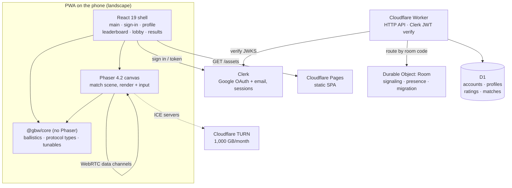

# ADR-0001 — Phaser 4 + React 19 client on Vite, Cloudflare Worker + Durable Objects backend, Clerk auth, D1 data

## Context

The brief fixes most of the stack as a client constraint: a mobile-first landscape PWA, Phaser 4 for gameplay, a
Cloudflare Worker + Durable Object for signaling only, WebRTC for gameplay traffic, Cloudflare Pages for hosting, and
free-tier cost ceilings throughout (`docs/00-source/brief.md` §6, §10; source `FR-04`, `NFR-02`, `NFR-04`).

Three layers were still open when this ADR was written:

- **Non-gameplay UI** — eight screens (main, sign-in, profile, leaderboard, lobby, match HUD, results) carry lists,
  forms, modals and focus management that a canvas does badly.
- **Auth** — v1 needs accounts for server-side Elo (`OQ-05`, `OQ-26`), and building session handling by hand is the
  single largest security risk in a 3-month delivery (`docs/04-decisions/open-questions.md` OQ-26).
- **Server data** — accounts, profiles, ratings, match records and the leaderboard need a store with joins and sorting.

Verified at decision time (2026-11-04, closes `VF-01`–`VF-03`): Phaser 4 is stable (v4.0.0 Apr 2026, v4.2.1
9 Jul 2026); WebSocket upgrades on the Workers **Free** plan count as one request and messages are free; Durable
Objects run on Workers Free with SQLite-backed storage (100 classes, 5 GB); Cloudflare D1 Free allows 5M rows read and
100k rows written per day, 500 MB per database, with daily limits enforced since 2026-09-01.

## Decision

Build the client as a **React 19 shell** on **Vite 8 + TypeScript 5**, hosting Phaser **4.2** in one canvas as a
self-contained layer; put game physics and the wire protocol in a **Phaser-free TypeScript package**; run a single
**Cloudflare Worker** that serves the HTTP API, verifies **Clerk** session JWTs, and hosts one **Durable Object class**
per room for signaling and migration; keep all relational data in **Cloudflare D1**; ship the SPA from **Cloudflare
Pages**.

## Diagram

## Options considered

| Option | Pros | Cons |
|--------|------|------|
| **Phaser 4.2 + React 19 + Vite + TS / Worker + DO / Clerk / D1** | Canvas gets the game, DOM gets the forms; pure-TS core is unit-testable without a browser (spec `§4`); free tier covers every quota with headroom; managed auth removes the highest-risk code path | Two view layers to keep coherent (`<canvas>` sizing, focus, back button); Clerk is a third-party dependency on the sign-in path and holds PII |
| Unity / Godot WebGL export | One engine for everything, strong tooling | 15–40 MB download breaks `NFR-01` (< 5 MB first load); physics and protocol live outside TypeScript so the shared `@gbw/core` and its unit tests disappear; PWA/Safari fit is poor |
| Phaser 3 + vanilla DOM | Same engine family, no React | Phaser 3 is on maintenance while 4 is the supported line; hand-written DOM for 7 screens burns the schedule for no user-visible gain |
| Server-authoritative physics on the Worker | Cheating becomes impossible server-side | Violates the source's hard constraint (10 ms CPU per request cannot run per-frame physics) and the free-tier request budget; would force a different host |
| PixiJS + own game loop | Smaller renderer, full control | We would rebuild scenes, input, scaling (`Phaser.Scale.FIT`) and asset loading that Phaser already ships |
| Custom auth on the Worker (Google OAuth by hand) | No vendor, no PII escrow | We own state/nonce, cookie rotation, session revocation and breach response — unacceptable risk in a 12-week delivery (`docs/rules/06-security.md` §5) |

## Consequences

- **Easier:** forms, lists and routing use React; the ballistics module runs in Vitest with no canvas; auth is a
  redirect + a JWKS verification; every store is SQL.
- **Harder:** the canvas and the DOM shell must agree on layout, orientation lock and focus restore; two build targets
  (Pages + Worker) and two deploy steps per release.
- **New constraints:** Clerk user ids (`sub`) become the foreign key for `Account` — an auth-vendor migration would be
  a data migration. Clerk free tier is 50,000 monthly retained users, after which the client pays $25/mo Pro.
- **Follow-ups:** `ADR-0002` (Clerk integration and PII), `ADR-0003` (D1 schema ownership), `ADR-0004` (P2P topology);
  a dedicated security review of the sign-in path before `M2` (`OQ-26`).
- **Revisit when:** Clerk pricing or its free tier changes materially; Phaser 4 drops a renderer we depend on; the
  leaderboard outgrows D1 read limits (then `ADR-0003` gets a cache).
