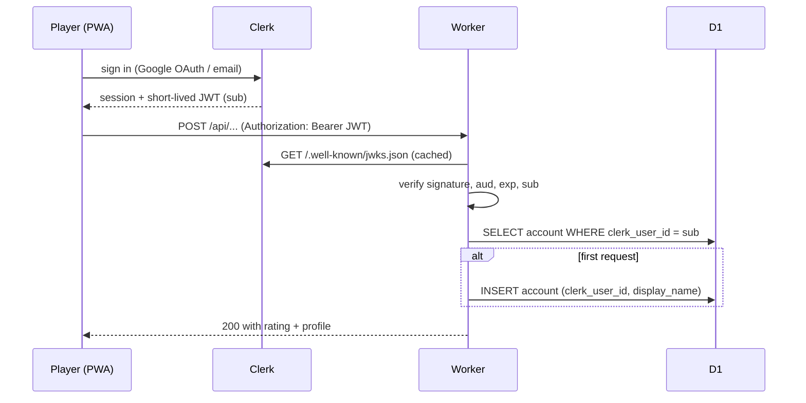

# ADR-0002 — Clerk holds identity and sessions; the Worker verifies JWTs and mirrors a profile row by Clerk id

## Context

v1 awards rating points server-side (`docs/00-source/brief.md` §8), so the backend must know who a player is. The
brief's assumption was Google OAuth + email magic link with a self-managed cookie session and D1 storage
(`OQ-26`). That means owning password reset, OAuth state/nonce, session revocation, breach response and the privacy
policy around stored PII — flagged by `docs/rules/06-security.md` §5 as a stop-and-review area.

Constraints: anonymous guests must still play (no forced sign-in), free-tier cost, mobile Safari (ITP, third-party
cookie blocking), and a 12-week schedule with one client team.

## Decision

Use **Clerk** as the identity provider for registered players. The client uses Clerk's components for Google OAuth and
email sign-in; the Worker verifies the Clerk session JWT against Clerk's JWKS before any rated match is recorded; D1
keeps a thin `Account` row keyed by Clerk's `sub` claim. Guests keep playing with a local guest identity and **no**
rated matches.

## Diagram

## Options considered

| Option | Pros | Cons |
|--------|------|------|
| **Clerk** | Managed sessions, OAuth, email verification and user deletion; JWKS verification is stateless on the Worker; free to 50k monthly retained users; vendor holds PII under a DPA | Third-party dependency on the sign-in path; login is a Clerk-hosted component/domain; $25/mo Pro beyond the free tier; user ids are Clerk-owned |
| Better Auth 1.5 on D1 | No vendor, MIT, native D1 binding, PII stays in our account | We own migrations, OAuth configuration, email sender and the whole security review; more work inside 12 weeks |
| Hand-rolled Google OAuth | No dependency, full control | Owns every security edge case in `rule 06` §5 with the least time and the fewest eyes |
| No accounts (ratings local) | Simplest, no PII at all | Rating would be client-side and therefore forgeable — contradicts §8 of the brief |

## Consequences

- **Easier:** no password storage, no session table, no reset flow; deleting a player is a Clerk + D1 operation with a
  documented path (`06-security.md` §1: no secrets in code — Clerk keys live in Worker secrets and `.env.example`).
- **Harder:** guests and registered players are two identity paths in the lobby; Clerk outage = registered players
  cannot sign in (guests still play); rating rows must tolerate a Clerk id that no longer exists.
- **Data protection:** D1 stores no email unless the product needs it — the mirror row keeps `clerk_user_id`,
  `display_name`, `avatar_id`, `rating`; email stays at Clerk (`OQ-26`).
- **Follow-ups:** privacy policy and data-deletion procedure before `M2`; Clerk DPA signed before go-live; dedicated
  security review of the auth path (`OQ-26`, `OQ-27`).
- **Revisit when:** Clerk free tier or pricing changes, or the client requires self-hosted identity — then port
  `clerk_user_id` to an internal `account_id` and swap the verifier behind the same interface.
