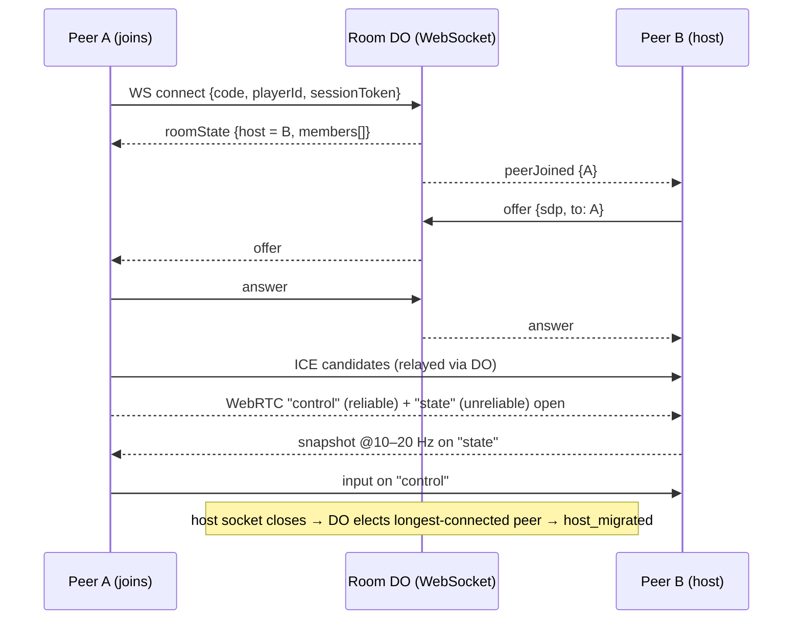

# ADR-0004 — Host-authoritative peer mesh over two WebRTC data channels; the Durable Object only signals and migrates

## Context

The source spec fixes the shape: physics runs on the client, gameplay traffic is peer-to-peer over WebRTC, and a
Cloudflare Worker + Durable Object handles only signaling and host migration (`gbw-spec.md` `§2.4`, `FR-03`, `FR-05`,
`FR-06`). The brief widened rooms to 1v1–4v4, i.e. up to 8 peers and — with a full mesh — up to 28 data-channel pairs,
which is what `OQ-24` was raised about.

Two channels are needed because input must never be lost while 10–20 Hz state snapshots may be: the source's packet
table (`§6.2`) mixes `input` into both channels, and that contradiction was recorded as a conflict in
`docs/00-source/ingest-report.md`.

Signaling transport was also open (`OQ-06`): the spec contradicts itself between WebSocket and HTTP polling.

## Decision

Run the match as a **host-authoritative peer mesh**: every peer connects to the host (up to 7 host links, not 28),
sends its input on a **reliable, ordered** data channel (`control`), and receives snapshots on an **unreliable,
unordered** channel (`state`, `maxRetransmits: 0`). Only the host runs the authoritative simulation; a non-host peer
predicts locally and reconciles to snapshots. Signaling, presence, matchmaking-by-code and host migration run over a
**WebSocket** to the `Room` Durable Object, which is the only stateful server component.

## Diagram

## Options considered

| Option | Pros | Cons |
|--------|------|------|
| **Host-authoritative star (chosen)** | 7 links instead of 28 — fits mobile uplink and `OQ-24`; one authoritative simulation; migration is a host swap the DO can drive | Host uplink is the bottleneck: it relays every peer's view; host latency is felt by all |
| Full mesh, every peer simulates | No relay, lowest latency per pair | 28 links × ~200–400 B at 10–20 Hz exceeds budget; divergent simulations need consensus the spec does not define |
| Worker/DO relays snapshots over WebSocket | No NAT traversal problems, one server truth | Gameplay over WebSocket is forbidden by the spec's constraint; Workers Free request budget cannot carry 10–20 Hz fan-out |
| HTTP polling for signaling | Simplest Worker code | 1–3 s of added setup latency per peer, and the spec's own migration timing assumes push |

## Consequences

- **Easier:** bandwidth per peer is one snapshot stream from the host; host migration is "elect, resend full snapshot";
  the unreliable state channel drops stale frames instead of queueing them behind a stalled packet.
- **Harder:** the host sends `n-1` copies of each snapshot, so an 8-player room is 7 × ~300 B × 15 Hz ≈ 31 KB/s up;
  host frame rate suffers on weak uplinks and the runbook tracks it. Host-side input must be echoed inside snapshots.
- **Trust model:** the host is only *relatively* authoritative — a modified host client can claim anything. Rated
  matches therefore submit a `MatchRecord` that the Worker re-validates (participants, durations, score bounds) before
  computing Elo (`ADR-0003`). Full anti-cheat is out of scope for v1 and recorded as `OQ-30`.
- **Follow-ups:** `OQ-24` budget table in `02-reference/api/protocol.md`; TURN credentials are issued by the Worker with
  a 1-hour lease and never logged (`06-security.md` §1).
- **Revisit when:** 8-player rooms show host-uplink saturation in the load test (`OQ-24`), or Cloudflare adds a
  WebTransport option inside the free tier.
