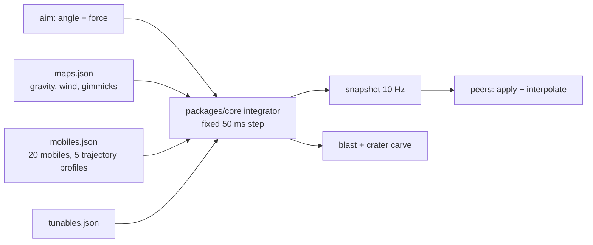

## Context

The client asked for GunBound's gameplay *including its physics* (`CR-2026-11-04-gb-gameplay-fidelity`). No published
specification of that physics exists, no other product's code or data is part of our basis (`OQ-18`,
`CR-2026-11-05-no-decompile`), and the source brief gives only a speed formula (`force × 512/100`) whose companion
`gravity 0.35` cannot be true on a 2,000-unit map.

We must therefore own an integrator that *behaves* the way the genre does, and be explicit that it is our model.

## Decision

`packages/core` owns a **deterministic, fixed-step artillery integrator**, parameterised entirely by data
(`tunables.json`, `mobiles.json`, `maps.json`), shaped by the genre conventions in
`reference-gunbound.md` § 10:

1. a fixed **50 ms** step — GunBound's own battle tick — stepped semi-implicitly, rendered with interpolation;
2. **one power law for every mobile** (`v0 = force × 6.2`), exactly as GB gives every mobile the same power bar;
3. **one gravity for the roster** (`100 u/s²`, bent only by the map's `gravityModifier`): at the same angle and power
   every mobile draws the *same* parabola, so a range learned on one mobile transfers to the next. The first version of
   this ADR gave each mobile its own gravity and mass (`84–128`, `118–169`) to make one fly flat and another lob short;
   that is the one thing the genre does *not* do, and it made the angle and power tables untransferable
   (`reference-gunbound.md` § 10, revised 2026-11-08);
4. wind acceleration `0.8 × wind` on the **horizontal axis only** — no vertical term and **no mass divisor**: GB's wind
   is east or west and it pushes every mobile alike, and **no drag at all**;
5. **per-mobile aim bands** (five trajectory profiles set the outer envelope, each mobile narrows it) plus seven shot
   classes (`arc`, `flat`, `lob`, `bounce`, `cluster`, `piercing`, `beam`) fixing the behaviour on impact;
6. terrain interaction by carving: a blast removes a circular crater and a projectile detonates on impact (or bounces,
   for `bounce` shots).

Calibration target: force 98 at 45° on `mbl-01` lands **3,680 units after 8.6 s** — nearly two map widths, so full
power clears the map and the aimed band sits at two thirds of the bar (force ~65 reaches a 1,640-unit spawn gap); the
same shot at wind +10 drifts 291 units and at full wind (26) 760, and every mobile drifts identically because the push
has no mass term. HP, shield and damage use a 1,000-point scale (900–1,200 HP, 180–580 per Inner
hit) to match the size of GunBound's health bars; the exact source values were server-side and do not survive
(`reference-gunbound.md` § *what the source cannot give us*).

The host runs the integrator and streams snapshots; every peer runs the same code for prediction and for adopting the
snapshot after a host change (`ADR-0004`). Determinism is a test requirement, not an aspiration: same seed + same inputs
⇒ same positions, asserted across the host and the peer path.

## Diagram

## Options considered

| Option | Pros | Cons |
|---|---|---|
| **Our integrator, data-driven (chosen)** | deterministic, unit-testable, matches the spec's "no physics on the Worker" constraint, tunable per map | feel is playtested, not measured |
| Physics engine (Matter.js / Rapier WASM) | rich collisions, robust terrain | non-deterministic across devices, +300 KB wasm against `NFR-03`, breaks `NFR-22` |
| Server-authoritative integration on the Worker | authoritative results, no host trust | violates the 10 ms CPU constraint in the spec § 2.4 and the P2P decision in `ADR-0004` |
| Precomputed trajectory tables | exact repeatability | cannot cover free aim, wind and terrain |

## Consequences

- Every balance change is a data change plus a `rulesetVersion` bump (`NFR-23`) — no code deploy needed.
- Fidelity work becomes a playtest loop: record reference behaviour, adjust `tunables.json`, assert with
  `TC-CORE-912` (shot classes) and `TC-CORE-913` (bounce/return).
- We must never claim numeric parity with GunBound: `OQ-37` records the limit and
  [`02-reference/gameplay/tunables.md`](../../02-reference/gameplay/tunables.md) § 10 repeats it.
- Determinism tests double as the regression net for the whole combat model (`TC-CORE-040`).
