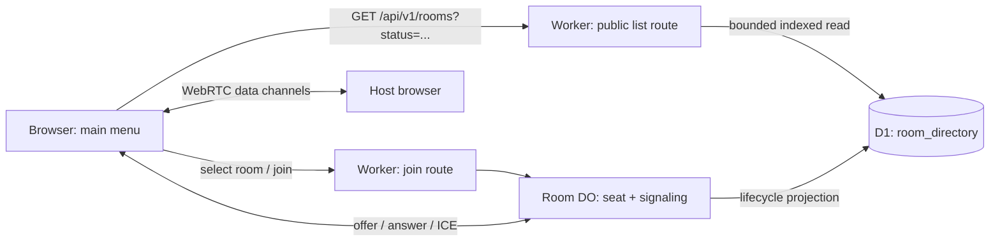

# ADR-0008 — D1 stores the public room directory; the Room Durable Object remains the live authority

## Context

The main menu needs to browse current public rooms without knowing a code. The list is a snapshot refreshed only when the
player opens it or changes a filter, so the read path can tolerate a few seconds of staleness. The live path cannot:
seat assignment, WebSocket authentication, signaling relay, host election, grace and migration are per-room ordered
operations.

Cloudflare D1 is a relational read model with cursor-friendly indexes and a 5M rows read/day Free allowance. Durable
Objects are the right authority for live rooms, but listing by enumerating DOs is not an available primitive and a
per-room alarm should not be spent on directory traffic.

## Decision

Store a narrow public-room projection in D1 (`room_directory`). The Room DO updates that projection on lifecycle
transitions and deletes it when the room closes. The Worker reads the projection with a bounded, filtered, cached query.
The Room DO remains the only authority for membership, seat assignment, signaling, host election and migration.

## Diagram

Diagram: Mermaid — archify is not installed in this project.

## Options considered

Criteria: directory freshness versus read cost, ability to operate the signalling authority, and cost to reverse.
Formatting, UI placement and filter names are ignored.

| Option | Pros | Cons |
|---|---|---|
| **D1 projection + Room DO authority (chosen)** | One indexed read model; no DO enumeration; live authority remains ordered; bounded cache makes stale results acceptable | A small eventual-consistency window and lifecycle projection code |
| Global Directory DO | Consistent list updates; one object can fan out updates | A global hotspot; duplicates room membership and makes every list read compete with live rooms |
| Worker + D1 mailbox for list and signaling | No per-room DO | No socket registry or push; polling burns D1 reads; seat races need custom locking |
| VPS WebSocket server + Redis | Full control over sockets and list | New server, TLS, deployment, Redis, backups, DDoS and on-call; contradicts the thin Cloudflare architecture |

Pairwise result: D1+DO beats the global DO on operational isolation and read scale; the global DO only wins on list
consistency, which a five-second snapshot does not require. D1+DO beats Worker+D1-only because D1 has no push or
per-room serialization. Worker+D1-only beats VPS+Redis on operational cost, but loses the live path. D1+DO beats
VPS+Redis on reversibility and operations for the same P2P topology.

## Consequences

- **Easier:** room discovery becomes a cacheable D1 read; the live room keeps one authority; no new vendor or runtime.
- **Harder:** the DO must keep the projection in sync; stale rows need expiry and join-time validation.
- **Limits:** directory writes are lifecycle-only, never heartbeat or snapshot traffic. A room costs one row write per
  create/join/leave/start and one delete on close.
- **Security:** the directory contains no identity, token, IP or socket data; private rooms are filtered out.
- **Revisit when:** list reads exceed the D1 free allowance at the launch target, or the product needs live updates,
  player identity in listings or spectator joins.
