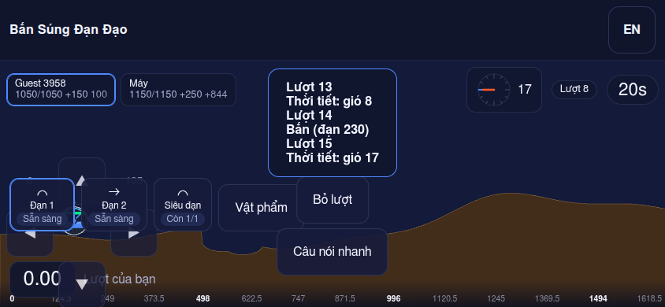

# Evidence — US-MATCH-003 (HUD: HP, wind, the clock, the roster)

Recorded 2026-11-07 on the Vite dev server (`http://localhost:5273`) with Chrome DevTools, viewport emulated at
**844×390, mobile, touch, landscape** (iPhone 12 class), against a bot match (`/match/AAAAAA`).

## Automated

| AC | Evidence |
|----|----------|
| AC1 values equal the snapshot | `TC-MATCH-903`, `TC-MATCH-933` — `apps/web/tests/roster.test.tsx` |
| AC2 the clock | `TC-MATCH-932` — `apps/web/tests/clock.test.tsx` |
| AC3 one announcement | `TC-MATCH-904` — `tests/e2e/pwa-a11y.spec.ts` |
| AC5 a wreck shows `0` and the marker | `TC-MATCH-933`, `TC-MATCH-925` — `apps/web/tests/roster.test.tsx` |
| AC6 zero wind, AC9 twelve ticks | `TC-MATCH-923` — `apps/web/tests/wind-dial.test.tsx` |
| AC8 the delay column | `TC-MATCH-933` — `apps/web/tests/roster.test.tsx` |
| AC10 the wind banner | `TC-MATCH-931` — `apps/web/tests/weather-banner.test.tsx` |
| AC11 the pad rings the mobile | `TC-MATCH-930` — `apps/web/tests/pad-layout.test.tsx` |
| AC4 target sizes, AC7 200 % text | run by `TC-PWA-160` and `TC-PWA-159` — `tests/e2e/a11y.spec.ts`, see the manual rows |

## Browser check (AC11, the layout defect recorded on 2026-11-06)

`padLayout` clamps the reported point into a 192 px box; on the emulated phone the box came back at
`left 8, top 190, bottom 382` (`right 200`) for this client's mobile standing near the map's left edge, with
`data-focus="mobile"` and `opacity: 0.8`. On the same screen the round chip read `Lượt 8`, the clock `20s`, and the
roster showed the absolute delay for the active seat (`100`) and the signed distance for the other (`+844`, a bot that
sat out several turns).

The screenshot below is a later frame of the same match: the ring (▲◀▶▼ at 80 % opacity) is centred on the mobile, so
the hull stays visible inside it, and the four buttons are the only controls drawn near the aim.

Still open, and outside this story: the weapon/item strip keeps its own bottom-left corner, so on this screen it sits
under the pad and under the mobile when the aim is at the far left (`US-MATCH-003` § 5 forbids a control over the aim
area; the strip's placement belongs to the follow-up recorded in the delivery block).

## Manual rows still owed

`TC-MATCH-934` (AC4) and `TC-MATCH-935` (AC7) are run by the accessibility sweep on a device; record the result here when
it is executed at the M2 UAT.
